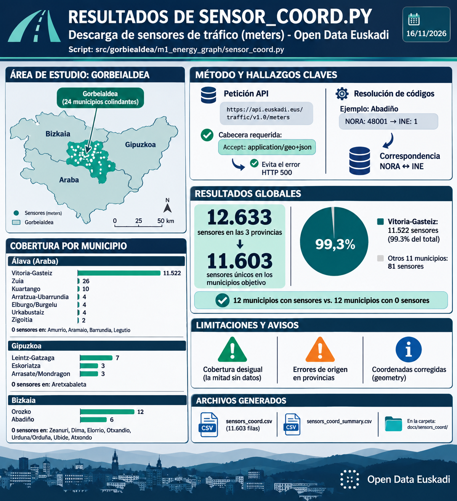
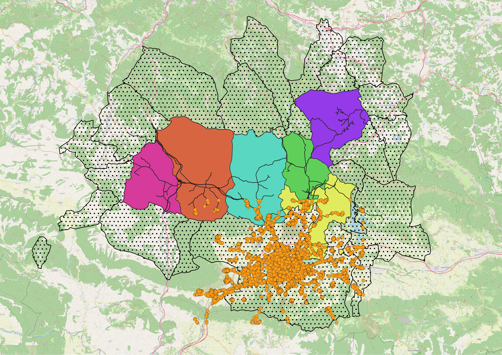

# Results of `sensor_coord.py`

Download of traffic sensors (*meters*) from the Open Data Euskadi API for 24 selected municipalities.

- **Script:** `src/gorbiealdea/m1_energy_graph/sensor_coord.py`
- **API:** `https://api.euskadi.eus/traffic/v1.0/meters`
- **Execution date:** 16/11/2026
- **Outputs:** `docs/sensors_coord/sensors_coord.csv`, `docs/sensors_coord/sensors_coord_summary.csv`

---

## Context and purpose

The 24 queried municipalities were chosen because they **border the case study area, Gorbeialdea**.

This script, located in `src/gorbiealdea/m1_energy_graph/`, is a **preliminary step**: it downloads the complete sensor inventory for those municipalities so that **those of interest for the model can be filtered later in Excel**.

---

## 1. What the script does

1. Queries the sensors of the 3 provinces (`/meters/byProvince/{provinceId}`), with full pagination.
2. Flattens each GeoJSON *feature*: merges `properties` with the `geometry` coordinates.
3. Keeps only the sensors from the 24 target municipalities, filtering by `municipalityId`.
4. Removes duplicates (`sourceId:meterId` key).
5. Writes the sensors CSV and a summary with the number of sensors per municipality, including those with 0.

### Key technical finding

The `meters` endpoints produce `application/geo+json`. With the `Accept: application/json` header, the server responds with **HTTP 500 with all fields set to `null`**, even on `/meters` without parameters. The script sends `Accept: application/geo+json`, and with that it works.

### Code mapping

The API IDs (NORA codes) match the **last 3 digits of the INE code**, and the province uses the same values (1, 20, 48).

| Municipality | INE | API ID |
|---|---|---|
| Abadiño | 48001 | 1 |
| Orozko | 48075 | 75 |
| Bilbao | 48020 | 20 |
| Iurreta | 48910 | 910 |

This was verified using the list of Bizkaia municipalities returned by the API.

---

## 2. Global results

| Province | API ID | Sensors in province | Sensors in your municipalities | Pages |
|---|---|---|---|---|
| Araba/Álava | 1 | 11,611 | 11,572 | 581 |
| Gipuzkoa | 20 | 770 | 13 | 39 |
| Bizkaia | 48 | 252 | 18 | 13 |
| **Total** | | **12,633** | **11,603** | |

- **Total unique sensors downloaded:** 11,603
- **Query errors:** none
- **Municipalities with at least one sensor:** 12 of 24
- **Municipalities with no sensors:** 12 of 24

---

## 3. Results by municipality

### Araba/Álava

| Municipality | INE | Sensors |
|---|---|---|
| Amurrio | 01002 | 0 |
| Aramaio | 01003 | 0 |
| Arratzua-Ubarrundia | 01008 | 4 |
| Barrundia | 01013 | 0 |
| Zigoitia | 01018 | 2 |
| Kuartango | 01020 | 10 |
| Elburgo/Burgelu | 01021 | 4 |
| Urkabustaiz | 01054 | 4 |
| Legutio | 01058 | 0 |
| Vitoria-Gasteiz | 01059 | 11,522 |
| Zuia | 01063 | 26 |

### Gipuzkoa

| Municipality | INE | Sensors |
|---|---|---|
| Aretxabaleta | 20013 | 0 |
| Eskoriatza | 20034 | 3 |
| Arrasate/Mondragon | 20055 | 3 |
| Leintz-Gatzaga | 20068 | 7 |

### Bizkaia

| Municipality | INE | Sensors |
|---|---|---|
| Abadino | 48001 | 6 |
| Zeanuri | 48024 | 0 |
| Dima | 48026 | 0 |
| Elorrio | 48032 | 0 |
| Otxandio | 48072 | 0 |
| Urduna/Orduna | 48074 | 0 |
| Orozko | 48075 | 12 |
| Ubide | 48088 | 0 |
| Atxondo | 48091 | 0 |

---

## 4. Interpretation

### 4.1 Vitoria-Gasteiz dominates the dataset

Vitoria-Gasteiz accounts for 11,522 of the 11,603 sensors (**99.3%**). Excluding it leaves **81 sensors spread across 11 municipalities**. Any aggregated analysis that does not separate Vitoria will be dominated by it.

Many of these records are likely individual detectors (for example, per lane or direction) rather than distinct measurement points. **This is unverified:** the `etd`, `detector`, `sourceId`, and `system` columns in the CSV need to be checked. If that is the case, grouping by `etd` will yield the actual measurement points.

### 4.2 Zeros are real

A direct query for Amurrio (`/meters/byMunicipality/1/2`) was tested: it returns **HTTP 200 with `totalItems: 0`**, meaning the query is valid and the API has no sensors in that municipality. In addition, the Bizkaia list only contains 16 municipalities, and out of the 9 target municipalities in that province, only Abadiño and Orozko appear.

A 0 means that **the API has no sensors assigned to that municipality**. It does not mean there is no traffic, nor that there are no traffic counting stations on roads within its territory managed by other sources.

### 4.3 Coverage in rural municipalities

With sensors (excluding Vitoria): Zuia (26), Orozko (12), Kuartango (10), Leintz-Gatzaga (7), Abadino (6), Arratzua-Ubarrundia (4), Elburgo/Burgelu (4), Urkabustaiz (4), Eskoriatza (3), Arrasate/Mondragon (3), and Zigoitia (2).

Without sensors: Amurrio, Aramaio, Barrundia, Legutio, Aretxabaleta, Zeanuri, Dima, Elorrio, Otxandio, Urduna/Orduna, Ubide, and Atxondo.

---

## 5. Limitations and caveats

- **Uneven coverage.** Half of the municipalities have no data in this API, so it cannot serve on its own as a homogeneous source for a rural mobility model.
- **Province assignment not always reliable.** In the Bizkaia query, Asparrena (a municipality in Araba) appeared with `municipalityId` 9. It does not affect this list of municipalities, but it indicates that the source data may have assignment errors.
- **Coordinates.** The API documentation shows `latitude` and `longitude` in `properties` swapped. The script uses the coordinates from `geometry` (GeoJSON `[longitude, latitude]`) and overwrites those two columns.
- **Inventory only.** The script downloads sensor locations and metadata, not the measurements (traffic counts). Measurements are in the `/flows/...` endpoints.

---

## 6. Generated files

| File | Content |
|---|---|
| `docs/sensors_coord/sensors_coord.csv` | One row per sensor (11,603). Includes `meterId`, `sourceId`, `meterCode`, `description`, `etd`, `detector`, `system`, `municipality`, `municipalityId`, `province`, `provinceId`, `postalCode`, `latitude`, `longitude`, `geometry_type`, and the `query_*` columns |
| `docs/sensors_coord/sensors_coord_summary.csv` | Sensors per municipality, including 0s |
| `docs/sensors_coord_errors.txt` | Only created if there are errors (this run did not generate it) |

The exact list of columns depends on what the API returns.